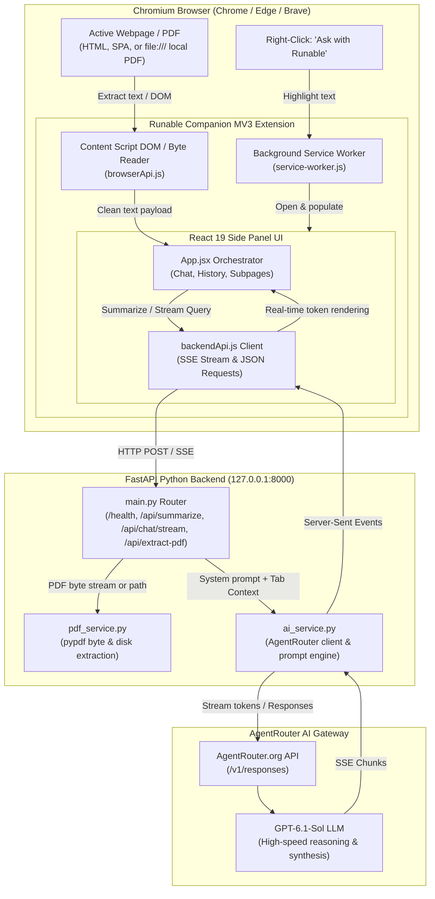

# Runable Companion ⚡

<p align="center">
  
</p>

<p align="center">
  <strong>Bringing the power of Runable AI into every browser tab.</strong><br>
  <em>An ambient, context-aware Chromium side panel companion that grounds Runable's intelligent agent in your active browsing workflow.</em>
</p>

<p align="center">
  
  
  
  
  
  
  
  
</p>

---

## 🌟 Executive Summary & Origin Story

> *"Sometimes, instead of just applying for a role, I believe in taking an extra step to share an idea and demonstrate what it could become."*

**Runable Companion** was conceived and engineered by **Sunil Kumar P** alongside his application for the **Software Engineer Intern (New Grad)** role at [Runable](https://runable.com). 

Rather than presenting standard resume bullet points alone, this project transforms a formal product proposal into an end-to-end, working demo prototype. It demonstrates how Runable's powerful agent platform can step beyond the boundaries of its standalone web application and live directly within the user's daily browsing stream—across articles, technical documentation, spreadsheets, and local PDFs.

This initiative is inspired by and builds upon Sunil's prior experience engineering and publishing [**GitPulse**](https://github.com/sunilkumar1701/GitPulse) (an AI-powered GitHub analytics extension with a FastAPI backend, MCP orchestration, and Microsoft Edge Add-ons release).

---

## 💡 The Core Problem & Opportunity

| Current Workflow Challenge | The Runable Companion Solution |
| :--- | :--- |
| **Tab-Switching Friction:** Users reading documentation, comparing SaaS offerings, or conducting research must continually leave their active tab to consult an AI assistant. | **Ambient Side Panel (`Alt + R`):** Opens instantly in the browser's native side panel alongside the webpage without losing scroll position or context. |
| **Copy-Paste Fatigue:** Highlighting paragraphs, opening a new tab, pasting text, and formulating prompt context wastes cognitive effort and time. | **Ask with Runable:** Direct selection context menu that pipes highlighted excerpts and source URLs into Runable with a single right-click. |
| **Page Blindness:** Traditional chatbots know nothing about the document currently in front of the user unless manually uploaded or prompted. | **Unified Page Grounding:** Native DOM extraction for dynamic SPAs, news articles, and local/remote PDFs with real-time context synchronization. |
| **Document Silos:** Local files (resumes, whitepapers, contracts) opened in browser tabs are traditionally inaccessible to extension context scripts. | **Hybrid PDF Reader Pipeline:** Direct filesystem path decoding and base64 byte streaming using `pypdf`, handling local `file:///` URLs effortlessly. |

---

## ✨ Key Features

### 1. 🖥️ Ambient Runable Side Panel (`Alt + R`)
- Built on Chrome's modern **Manifest V3 `sidePanel` API**, coexisting alongside any webpage without intrusive overlays or screen real-estate collisions.
- Configurable global keyboard shortcut (`Alt + R`) to invoke or dismiss the panel instantaneously.
- Designed with pixel-accurate adherence to Runable's design language: warm off-white palette (`#faf8f5`), modern typography, soft rounded cards, and smooth micro-interactions.

### 2. 🖱️ "Ask with Runable" Selection Menu
- Highlight any phrase, paragraph, or code snippet on any webpage.
- Right-click and select **"Ask with Runable"**.
- Automatically slides open the companion, pins a sleek **"Selected from webpage"** card with source domain attribution, and focuses the composer for targeted inquiries.

### 3. 📄 One-Click "Summarize This Page"
- Instantly analyzes the active tab's content.
- Generates a structured two-part response:
  - **Executive Summary:** A concise, synthesized overview of the topic and main narrative.
  - **Key Takeaways:** 3–5 bullet points highlighting core insights, metrics, and actionable items.
- Live URL source badge linking directly back to the active page.
- Composer placeholder automatically transforms to *"Ask a follow-up question..."* for conversational deep dives.

### 4. 📑 Deep Local & Remote PDF Analysis (`file:///*`)
- Seamlessly extracts text from both online web PDFs and local machine files (e.g., `file:///D:/Resume/.../SUNIL_KUMAR_P.pdf`).
- Dual-tier extraction pipeline:
  1. Direct local disk path extraction via backend for near-instant access.
  2. In-extension base64 byte-streaming fallback via Chrome Service Worker and `pypdf`.
- Formatted with structured page delimiters (`--- Page 1 ---`), encrypted PDF detection, and clear notifications for scanned/image-only documents.

### 5. 🔄 Stale Context Invalidation & Live Tab Grounding
- Overcomes the classic extension bug where an AI retains context from an old tab after switching.
- Actively verifies tab URLs before prompting. If the user moves from LinkedIn to a Wikipedia page or PDF, the previous document context is automatically invalidated and refreshed.

### 6. ⚡ Real-Time SSE Streaming with `gpt-6.1-sol`
- Powered by a high-performance **FastAPI** backend integrated with **AgentRouter** (`https://agentrouter.org/v1/responses`).
- Utilizes the advanced **`gpt-6.1-sol`** reasoning model.
- Server-Sent Events (SSE) stream responses token-by-token directly to the React UI with sub-50ms initial chunk latency.

### 7. 🗂️ Chat History Drawer & Full Subpage Suite
- **Chat History:** Slide-out drawer with chronological grouping (*Today*, *Previous 7 Days*), live keyword search, and individual conversation deletion.
- **Product Ecosystem Drawers:** Pre-wired subpages mirroring Runable's enterprise platform:
  - 🎨 **Artifacts:** Interactive view for AI-generated slide decks, reports, and code modules.
  - ⏱️ **Scheduled Tasks:** Automated monitoring workflows with interactive toggle states.
  - 🔌 **Plugins:** Integrations for Google Drive, Gmail, Slack, and Notion.
  - 📝 **Meeting Notetaker:** Live transcriptions, attendee tracking, and key action items.
  - ⚙️ **Settings & Account:** Theme controls, keyboard customization guide, and user profile management.

---

## 🏛️ System Architecture



---

## 🛠️ Technology Stack

| Layer | Technologies | Purpose |
| :--- | :--- | :--- |
| **Extension Framework** | Chrome Manifest V3, `chrome.sidePanel`, `chrome.contextMenus`, `chrome.commands` | Modern, secure, memory-efficient browser integration without background page bloat. |
| **Frontend UI** | React 19, Tailwind CSS v4, Lucide React, Vite 8 | Ultra-fast build times, zero legacy CSS overhead, fluid responsive layout for narrow side panels. |
| **Backend API** | FastAPI, Uvicorn, Python 3.14, Pydantic v2 | High-concurrency async ASGI server delivering streaming endpoints and document processing. |
| **AI & LLM Gateway** | AgentRouter, OpenAI Python SDK, `httpx` | Robust proxying to `gpt-6.1-sol` using OpenAI-compatible response formatting. |
| **Document Processing** | `pypdf 5.x`, base64 encoding, Windows filesystem path normalization | Robust extraction across complex multi-page PDF documents and local disk URIs. |
| **Testing & Quality** | Python `unittest`, custom 14-test live verification suite | End-to-end testing of CORS, API keys, live AgentRouter endpoints, and PDF parsing. |

---

## 📁 Repository Structure

```text
Runable Companion/
├── Idea Proposal/
│   └── Runable_Companion_Proposal_Sunil_Kumar.pdf # Original concept & strategy document
├── runable-companion/                             # Frontend & Chrome Extension MV3
│   ├── public/
│   │   ├── icons/                                 # High-res extension icons (16px, 48px, 128px)
│   │   ├── manifest.json                          # Manifest V3 configuration (sidePanel, commands, permissions)
│   │   └── service-worker.js                      # Background worker (context menu, shortcuts, PDF fetch fallback)
│   ├── src/
│   │   ├── components/
│   │   │   ├── ChatComposer/                      # Dynamic multiline input with toolbar & send triggers
│   │   │   ├── ConversationView/                  # Left/right message bubbles, Markdown formatting & copy actions
│   │   │   ├── Dropdown/                          # Clean floating agent & model selector menus
│   │   │   ├── Header/                            # Brand header with Logo, Chat History, More Options, Close
│   │   │   ├── HistorySidebar/                    # Slide-out drawer with search, date grouping & delete actions
│   │   │   ├── MenuPageLayout/                    # Common header wrapper for in-extension subpages
│   │   │   ├── MoreOptionsMenu/                   # Quick navigation menu to all platform modules
│   │   │   ├── PageSummary/                       # Shimmering loading states & structured summary cards
│   │   │   ├── QuickActions/                      # Action pills (Summarize, Slides, Reports, More Tools)
│   │   │   ├── SelectedContextCard/               # Inset card displaying webpage text selections
│   │   │   └── WelcomeSection/                    # Ambient greeting with 4-point sparkle icon
│   │   ├── pages/                                 # Deep Runable ecosystem views (Artifacts, Plugins, Settings, etc.)
│   │   ├── services/
│   │   │   ├── backendApi.js                      # SSE streaming and REST client communicating with FastAPI
│   │   │   ├── browserApi.js                      # Safe chrome.* API wrappers, DOM crawler & PDF pipeline
│   │   │   └── mockSummaryService.js              # Graceful offline fallback data
│   │   ├── styles/
│   │   │   ├── global.css                         # Tailwind v4 import & custom scrollbar definitions
│   │   │   └── variables.css                      # Theme design tokens & warm palette hex codes
│   │   ├── App.jsx                                # Root state orchestrator, tab tracker & event coordinator
│   │   └── main.jsx                               # React root mounting point
│   ├── backend/                                   # FastAPI Python AI Backend
│   │   ├── app/
│   │   │   ├── prompts/                           # Carefully engineered system prompts for page grounded QA
│   │   │   ├── services/
│   │   │   │   ├── ai_service.py                  # AgentRouter SSE streaming client & structured summary parser
│   │   │   │   └── pdf_service.py                 # High-speed text extraction from PDF bytes or local file paths
│   │   │   ├── config.py                          # Environment validation & CORS settings
│   │   │   ├── main.py                            # FastAPI endpoints (/health, /api/summarize, /api/chat/stream)
│   │   │   └── schemas.py                         # Pydantic models for type-safe requests and responses
│   │   ├── test_suite.py                          # 14 automated verification tests (health, streaming, PDF, CORS)
│   │   ├── requirements.txt                       # Pinned Python dependencies
│   │   └── .env.example                           # Template for API keys and configurations
│   ├── package.json                               # Node dependencies and build scripts
│   └── vite.config.js                             # Vite configuration with Tailwind CSS v4 plugin
└── README.md                                      # Project overview and documentation
```

---

## 🚀 Quickstart & Installation Guide

Follow these steps to run both the FastAPI AI backend and the Chromium extension locally.

### 1. Prerequisites
- **Node.js** (v18.0.0 or higher) & **npm**
- **Python** (v3.10 to v3.14)
- **Google Chrome** or **Microsoft Edge**

---

### 2. Backend Setup (FastAPI & AgentRouter)

1. Open PowerShell / Terminal and navigate to the backend directory:
   ```bash
   cd "runable-companion/backend"
   ```

2. Create and activate a Python virtual environment:
   ```powershell
   # Windows (PowerShell)
   python -m venv .venv
   .\.venv\Scripts\Activate.ps1

   # macOS / Linux
   python3 -m venv .venv
   source .venv/bin/activate
   ```

3. Install the dependencies:
   ```bash
   pip install -r requirements.txt
   ```

4. Configure your environment variables:
   - Copy `.env.example` to `.env`:
     ```bash
     cp .env.example .env
     ```
   - Open `.env` and verify your AgentRouter credentials:
     ```env
     AGENTROUTER_API_KEY=your_agentrouter_api_key_here
     AGENTROUTER_BASE_URL=https://agentrouter.org/v1
     AGENTROUTER_MODEL=gpt-6.1-sol
     CORS_ORIGINS=*
     ```

5. Start the backend server:
   ```bash
   uvicorn app.main:app --host 127.0.0.1 --port 8000 --reload
   ```
   *The server will be live at `http://127.0.0.1:8000`. You can test health at `http://127.0.0.1:8000/health`.*

---

### 3. Frontend Setup (React Extension Build)

1. In a new terminal window, navigate to the extension root:
   ```bash
   cd "runable-companion"
   ```

2. Install Node dependencies:
   ```bash
   npm install
   ```

3. Build the production extension bundle:
   ```bash
   npm run build
   ```
   *This compiles the React 19 app and copies the manifest and icons into the `dist/` directory.*

---

### 4. Load the Extension in Chrome / Edge

1. Open your browser and navigate to `chrome://extensions` (or `edge://extensions`).
2. Toggle **Developer mode** in the top right corner.
3. Click the **Load unpacked** button.
4. Select the `dist/` folder located inside the `runable-companion` directory:
   ```text
   C:\Users\USER\OneDrive\Desktop\Runable Companion\runable-companion\dist
   ```
5. *(Crucial for PDF Reading)* Click **Details** on the Runable Companion card and enable:
   - **Allow access to file URLs** *(enables reading local resumes and documents)*.
   - Pin Runable Companion to your browser toolbar for easy access.

---

## 🧪 Verification & Automated Testing

The backend includes a comprehensive, automated test suite covering all integration points:

```bash
cd "runable-companion/backend"
.\.venv\Scripts\python.exe test_suite.py
```

### Test Suite Coverage:
- `test_health_endpoint`: Validates backend uptime, version, and model status.
- `test_cors_preflight`: Confirms Chrome extension origins are permitted.
- `test_summarize_mock_fallback`: Verifies graceful degradations when network drops.
- `test_summarize_live_agentrouter`: Confirms structured JSON summary responses from `gpt-6.1-sol`.
- `test_chat_stream_live`: Verifies SSE chunk-by-chunk delivery and stop tokens.
- `test_pdf_extraction_bytes`: Validates in-memory PDF parsing and page boundary tracking.
- `test_pdf_extraction_file_path`: Tests local disk access for Windows `file:///` URLs.

---

## 💼 Strategic Business Value for Runable

```
                      ┌─────────────────────────────────────────┐
                      │          Runable Web Platform           │
                      │  (Full-stack IDE, Deployments, Agents)  │
                      └────────────────────▲────────────────────┘
                                           │
                                  Context Synced via
                                  Account & Projects
                                           │
                      ┌────────────────────▼────────────────────┐
                      │            Runable Companion            │
                      │     (Ambient Browser Intelligence)      │
                      └────────────────────┬────────────────────┘
                                           │
             ┌─────────────────────────────┼─────────────────────────────┐
             ▼                             ▼                             ▼
   Daily Active Retention         Zero-Friction Ingestion        Enterprise Workflows
• 10x more user touchpoints     • Select text -> Runable       • Live meeting notetaker
• No need to switch tabs        • Webpage summary -> Project   • Instant PDF contract analysis
```

1. **Massive Increase in Daily Active Touchpoints:** Rather than waiting for users to initiate work inside the main web dashboard, Runable is present every time a user conducts research, reads documentation, or analyzes competitors.
2. **Native Pipeline into Runable Artifacts:** Summaries, extracted code snippets, and research generated in the side panel can be directly saved into Runable Projects, Pitch Decks, and Deployable Apps.
3. **Low Infrastructure Overhead:** Utilizes existing AgentRouter and model routing infrastructure without requiring custom standalone model hosting.

---

## 👨‍💻 About the Author & Candidate Initiative

**Sunil Kumar P**  
*Full-Stack & Generative AI Developer | Software Engineer Intern Candidate*

- **LinkedIn:** [Sunil Kumar P](https://www.linkedin.com/in/sunil-kumar-p17/)
- **GitHub:** [@sunilkumar1701](https://github.com/sunilkumar1701)
- **Portfolio / Live Project:** [GitPulse on Microsoft Edge Add-ons](https://microsoftedge.microsoft.com/addons/detail/gitpulse/lepaenbflcpokamnoilhengjcfcafdol)
- **Product Proposal Document:** [Runable Companion Proposal PDF](Idea%20Proposal/Runable_Companion_Proposal_Sunil_Kumar.pdf)

> **Disclaimer:** *Runable Companion is an independent prototype and concept demonstration designed specifically to showcase proactive product innovation and engineering depth for the Software Engineer Intern role at Runable. It is not an official Runable product.*

---

<p align="center">
  <sub>Built with ❤️ and dedicated to the <strong>Runable</strong> engineering and product leadership team.</sub>
</p>

